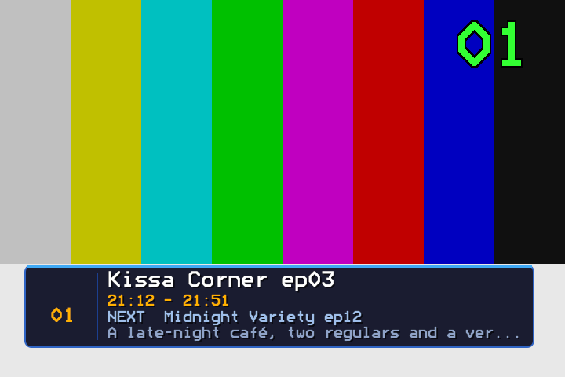

# nullaOS

A television that only exists on a real television.

nullaOS is a 720×480 broadcast simulator for Windows, built with PySide6 and
libVLC, and designed to drive an actual 4:3 CRT (in my case an Aiwa VX‑D2120 over
a composite/RGB converter). It is not a media player with a retro skin: the
scheduling, the commercial breaks, the guide and the on-screen furniture are all
modelled on how cable actually behaved.



## Why this exists

**It is a way out of the feed.** The whole thing started as a reaction to doom
scrolling — to the feeling of opening an app that has nothing to end, nothing to
miss and nothing to be late for. A channel has all three. You tune in, you are
late for the beginning, you cannot scrub forward, and when the programme ends
you are done. Sitting in front of a screen that refuses to serve you the next
thing is a surprisingly effective way to stop.

**It is preservation work.** Broadcast is the most disposable medium we have
made: tapes get wiped, captures rot on failing drives, and the furniture around
the programmes — the idents, the ad reels, the guide grid, the way a channel
sounded at 2 a.m. — disappears first because nobody thinks of it as the work.
Encoding a 2003 Japanese variety show is only half the job; putting it back
inside a schedule, with its commercials in the right places and a banner that
names it, is the other half. Everything here is built to keep that context
intact and playable, not to reduce it to a file in a list.

**It is a study tool.** At the moment the main use is learning Japanese. A
channel assembled from real captures — commercials included — is immersion you
cannot get from a textbook: you hear the same phrases in the ad reel until they
stick, you read the guide grid, you catch the half-sentence before the break.
Because the schedule never waits for you, you learn to follow at broadcast speed
instead of pausing at every unknown word. That was not the original goal. It
turned out to be the best thing about it.

> Built with an AI pair — the architecture, the timeline maths and the CRT
> measurements are mine; the debugging discipline (offscreen harnesses, simulated
> broadcast days, the tests) is very much ours. Long projects like this are as
> much a conversation as they are code.

## What it does

* **Live TV with a real schedule.** Every channel is a broadcast timeline:
  programmes, commercial pods at fixed points inside long shows, and a pod
  between them. Join at any time and you land wherever the channel is — mid‑scene
  or mid‑commercial.
* **Commercials are part of the clock.** Each channel has its own break
  interval (−2…+2 min jitter), its own pool, and deterministic ad selection, so
  two channels never break together and a re‑tune doesn't reshuffle the pod.
* **An EPG that tells the truth.** The guide reads the same timeline as the
  player: real titles, real start/end times, a NOW line, and left/right to walk
  forward through 72 hours. A second muted libVLC player shows a live preview of
  the highlighted channel.
* **Channel banner.** Flick onto a station and a bar appears with the channel
  number, logo, programme title, times, what's next and a one‑line description.
  `I` brings it back.
* **A library.** On‑demand movies and shows with no commercial injection, plus a
  progress bar, resume‑free scrubbing and per‑file display overrides.
* **Per‑file display shape.** `A` cycles the display aspect, `C` cycles the crop;
  both are remembered per file (`display_overrides.json`) for those captures that
  only look right wider than 16:10.
* **Settings that belong on a TV.** VCR‑style clock (it drives the whole
  broadcast day), 12/24‑hour, commercials on/off, VLC `normvol` levelling for
  loud ad reels, volume with an OSD, and every key rebindable from the menu.
* **Seasonal and daypart pools.** Drop `Commercials/Christmas/` or
  `Commercials/Late Night/` into a channel and those ads only appear when they
  should; `Morning/` and `Late Night/` programme folders turn a channel into a
  clock‑anchored day.
* **A UI drawn for a CRT.** 1 px rules are banned, dithered textures are baked
  at half resolution then doubled, text sits inside the measured visible area,
  and the only "CRT effect" is the tube itself.

## Requirements

* Windows 10/11 (the overlay technique is Windows‑specific; see *How it works*)
* Python 3.10+ (developed against 3.13/3.15)
* [VLC 3.x](https://www.videolan.org/) installed — `python-vlc` binds to its
  `libvlc.dll`
* A 720×480 display for the real thing, or any monitor for a windowed run

```
pip install -r requirements.txt
```

`requirements.txt` pulls PySide6, python-vlc, pygame-ce (gamepad, optional) and
numpy (snow/glow). Without numpy the app still runs; the tuning snow is then a
flat black frame instead of noise.

## Running

```
python scripts/app.py                 # uses ./catalog if it has channel folders
python scripts/app.py --catalog D:\TV # or point it somewhere else
```

First run with an empty `catalog/` falls back to the mock catalog. Generate
SMPTE test patterns so there is something to tune into:

```
python scripts/test_pattern.py        # needs ffmpeg on PATH
```

`setup.bat` does the dependency checks, the pattern generation and the launch in
one double‑click.

## Catalog layout

The catalog is just folders — no database:

```
catalog/
├─ MOVIE WAVE/                 channel name = folder name
│  ├─ Breaker Night.mp4        any video file
│  ├─ Breaker Night.txt        optional: first line = blurb for the banner
│  ├─ Commercials/             this channel's ad pool (isolated)
│  │  ├─ Coke Ad.mp4
│  │  └─ Christmas/            seasonal pool: only 1 Dec – 6 Jan
│  │     └─ Snowman Ad.mp4
│  ├─ Late Night/              daypart pool: plays 23:00 – 05:00
│  │  └─ Late Show.mp4
│  ├─ Logos/logo.png           optional channel logo (watermark + guide + banner)
│  └─ channel.json             optional per‑channel settings
└─ Library/
   ├─ Movies/*.mp4             on‑demand, no commercials
   └─ TV Shows/<show>/*.mp4
```

`channel.json` (all keys optional):

```json
{
  "ad_every_min": 7,
  "ad_min": 2,
  "ad_max": 4,
  "deinterlace": "yadif2x",
  "aspect": "4:3"
}
```

`ad_every_min: 0` means "use the app default", a negative value disables
mid‑rolls for that channel. Recognised daypart folders: `Morning`, `Afternoon`,
`Evening`, `Prime Time`, `Late Night`, `Overnight`, `Night`. Seasonal:
`Christmas`/`Xmas`/`Holiday`, `Halloween`, `Summer`.

## Controls (defaults, all rebindable)

| key | action |
|---|---|
| ↑ / ↓ | next / previous channel (or move in lists) |
| ← / → | seek 30 s (library) · walk the guide |
| Space | pause (live) / play‑pause (library) |
| Enter | select / watch |
| Backspace | back, closes the banner first |
| G | TV guide |
| I | channel banner |
| V | library |
| P | channel picker |
| M | menu → settings |
| A / C | display aspect / crop for the current file |
| + / − | volume |
| Q | quit |

`settings.json` holds the clock offset, 12/24‑hour, ads on/off, audio levelling,
volume and your key bindings. `window_state.json` remembers where the borderless
window was left, per monitor.

## How it works

* **`scripts/timeline.py`** is the heart. A channel is either a rolling cycle
  (programme segments + pods, anchored to a persisted `start_time`) or a day of
  clock‑anchored windows when daypart folders exist. `airing_at(t)` answers
  "what is on right now", `programme_blocks()` answers "what does the guide
  list", and both come from the same data — which is why the guide, the banner,
  the preview and the player never disagree.
* **`scripts/overlay.py`** is a transparent, always‑on‑top window pinned over the
  video surface. libVLC renders into its own child HWND on Windows, so a normal
  Qt widget cannot paint above it; the overlay also carries the window drag.
* **`scripts/vlc_player.py`** wraps one `MediaPlayer` and works around this
  build's quirks: the crop is an instance‑level filter (`--crop=16:10`), the
  display aspect must be set at runtime, and MPEG‑PS seeks are by fraction, not
  by timestamp.
* **`scripts/preview.py`** is a second muted player for the guide's live panel;
  it stays hidden until it is actually showing the join position, so a stale
  frame never appears.
* **`scripts/screens/`** is one painted screen per mode (boot, live, guide,
  browser, picker, menu, settings) at exactly 720×480, with the measured visible
  area in `base.py` (`SAFE_*`) as the only layout authority.

## History

The full development log — every bug, its cause and the fix — is in
[CHANGELOG.md](CHANGELOG.md). A shorter narrative of the builds and what comes
next is in [docs/DEVELOPMENT.md](docs/DEVELOPMENT.md).

What is planned, and in which two-week iteration, lives on the
[project board](https://github.com/users/geo266/projects/2).

## Credits

* [python-vlc](https://github.com/oaubert/python-vlc) and VLC.
* [Bedstead](https://bjh21.me.uk/bedstead/) by Ben Grimmett — the pixel font the
  whole UI is set in (bundled in `assets/fonts/`).
* [MediaWave2000](https://github.com/Mamaweegee123/MediaWave2000) for the
  catalog conventions (folder = channel, `Commercials/` = pool).

This is a personal project; there is no licence file yet, so all rights are
reserved by default. Ask if you want to reuse something.
